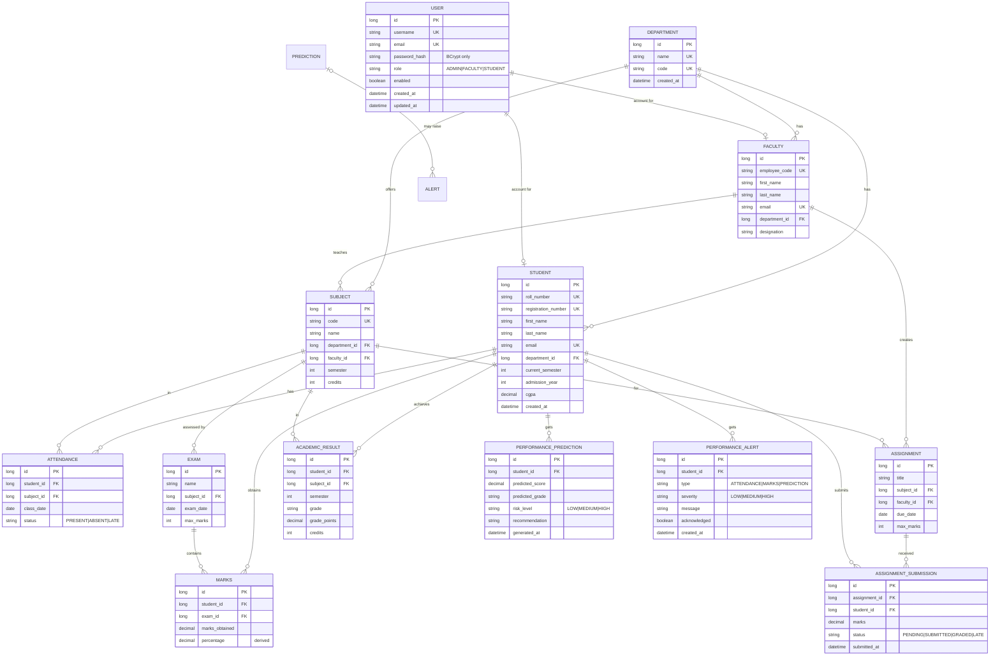

# Academic Performance Analytics & Prediction Platform

A full-stack web application that centralises academic records for a college —
departments, subjects, students, faculty, attendance, exams, marks, assignments
and semester results — then **analyses** each student's performance, produces an
**explainable predicted score/grade/risk**, and raises **early-warning alerts**
for students who are falling behind.

* **Backend:** Java 17 · Spring Boot 3.5.4 · Spring Data JPA · Spring Security · JWT · MySQL 8
* **Frontend:** React 18 · Vite 5 · React Router 6 · Axios · Recharts · plain CSS

> **Build status:** ✅ **All 21 stages complete.** `mvn clean verify` →
> **BUILD SUCCESS, 64 tests, 0 failures**; `npm run build` → production bundle in
> `dist/`. Every statement in this document was verified by building, running and
> exercising the software (REST calls + the React UI in a real browser). Nothing
> here is a mock-up: the frontend renders **real backend data only**.

---

## Table of contents

1. [Objective](#objective)
2. [Delivery roadmap](#delivery-roadmap)
3. [Technology stack](#technology-stack)
4. [User roles](#user-roles)
3. [Architecture](#architecture)
5. [Database design (ER diagram)](#database-design-er-diagram)
6. [Environment configuration](#environment-configuration)
7. [How to run the project](#how-to-run-the-project)
8. [REST API](#rest-api)
9. [Frontend screens](#frontend-screens)
10. [Sample development credentials](#sample-development-credentials)
11. [Testing](#testing)
12. [Performance prediction algorithm](#performance-prediction-algorithm)
13. [Early-warning alert rules](#early-warning-alert-rules)
14. [Security notes](#security-notes)
15. [Troubleshooting](#troubleshooting)
16. [Viva cheat-sheet](#viva-cheat-sheet)

---

## Objective

Provide one place where Admin, Faculty and Student can:

* manage students, faculty, departments and subjects,
* record attendance, exam marks and assignments,
* track previous-semester results and CGPA,
* view performance analytics as interactive charts,
* get a **predicted score, grade and risk level** for each student,
* receive **early-warning alerts** when attendance drops, marks decline, or the
  predicted performance is poor.

---

## Delivery roadmap

The project is built in 21 stages, all complete and verified.

| #  | Stage | Status |
|----|-------|--------|
| 1  | Project setup and architecture | ✅ Done |
| 2  | MySQL configuration and database entities | ✅ Done |
| 3  | Authentication and JWT security | ✅ Done |
| 4  | Student, faculty, department and subject management | ✅ Done |
| 5  | Attendance management | ✅ Done |
| 6  | Exam and marks management | ✅ Done |
| 7  | Assignment management | ✅ Done |
| 8  | Academic results and CGPA | ✅ Done |
| 9  | Analytics engine (overview / student / class) | ✅ Done |
| 10 | Performance prediction (transparent weighted model) | ✅ Done |
| 11 | Early-warning alerts | ✅ Done |
| 12 | REST API verification (integration tests) | ✅ Done |
| 13 | React frontend setup and design system | ✅ Done |
| 14 | Login, registration and role-based routing | ✅ Done |
| 15 | Student dashboard | ✅ Done |
| 16 | Faculty dashboard | ✅ Done |
| 17 | Admin dashboard | ✅ Done |
| 18 | Charts and analytics UI (Recharts) | ✅ Done |
| 19 | Search, filters, pagination and reports | ✅ Done |
| 20 | Testing, bug fixing and security review | ✅ Done |
| 21 | Documentation and final verification | ✅ Done |

**Verification summary**

* `mvn clean verify` → **BUILD SUCCESS**, **64 tests**, 0 failures/errors.
* `npm run build` → production bundle built successfully into `frontend/dist/`.
* Manual end-to-end check in a real browser: logged in as all three roles,
  exercised every screen against the live API — dashboards, all CRUD tables,
  analytics charts, the prediction panel and the alerts table all render real
  data with **no console errors**.

### What the backend delivers

* **13 JPA entities** (User, Department, Faculty, Student, Subject, Attendance,
  Exam, Marks, Assignment, AssignmentSubmission, AcademicResult,
  PerformancePrediction, PerformanceAlert) with correct relationships, unique
  constraints, a shared `BaseEntity` (`@MappedSuperclass`) and six enums.
* **13 Spring Data JPA repositories** with derived queries (unique lookups,
  attendance counts, "latest prediction", etc.).
* **Registration + login** (`POST /api/auth/register`, `POST /api/auth/login`) with
  BCrypt hashing, duplicate rejection (`409`), validation (`400`) and a signed
  **JWT** (JJWT 0.12.6, HS256).
* **Role-based security** (`SecurityConfig`): `/api/admin/**` = ADMIN,
  `/api/student/**` = STUDENT, academic + management endpoints =
  ADMIN/FACULTY, public endpoints stay open.
* **Management CRUD** for departments, subjects, students and faculty with
  server-side **search, filtering and pagination**.
* **Academic records** for attendance, exams, marks, assignments, submissions and
  results (CGPA is re-computed automatically on every result change).
* **Analytics** (`MetricsService`, `AnalyticsService`), **prediction**
  (`PredictionService`) and **early-warning alerts** (`AlertService`).
* **Role dashboards** (`DashboardService`) aggregating exactly what each role needs.
* A configurable, **idempotent demo seeder** (`DataSeeder`) that creates the demo
  accounts **and** a small academic history so every feature has real data to show.

### What the frontend delivers

* **React 18 + Vite** app with React Router, an Axios client reading the backend
  URL from `VITE_API_BASE_URL`, and a plain-CSS design system.
* **Login & registration** pages, a restored-session `AuthContext`, and a
  `ProtectedRoute` guard that redirects anonymous users to `/login` and
  unauthorised roles to `/forbidden`.
* **Role-specific dashboards** (Admin / Faculty / Student) dispatched from one
  `/app/dashboard` route.
* **Generic CRUD screens** (`CrudResourcePage` + `FormModal` + `DataTable` +
  `Pagination`) reused across every management and academic resource — fewer
  bugs, consistent UX.
* **Recharts analytics** (bar / line / pie / progress) and an **explainable
  prediction panel** that shows each indicator, its weight, the normalised score,
  the final estimate and any missing indicators.
* **Student self-service** pages that only ever show the signed-in student's own
  attendance, marks, assignments, results, CGPA and prediction.
* Search boxes, dropdown filters, pagination and responsive CSS throughout.

---

## Technology stack

**Backend**

| Concern | Technology |
|---------|------------|
| Language | Java 17 (verified running on JDK 25) |
| Framework | Spring Boot 3.5.4 (Spring Framework 6.2) |
| Web | Spring Web (REST) |
| Persistence | Spring Data JPA + Hibernate |
| Security | Spring Security + JWT (JJWT 0.12.6, HS256) |
| Validation | Bean Validation (`spring-boot-starter-validation`) |
| Build | Maven |
| Database | MySQL 8.0.46 |
| Password hashing | BCrypt (`BCryptPasswordEncoder`) |

**Frontend**

| Concern | Technology |
|---------|------------|
| Library | React 18 |
| Build tool | Vite 5 |
| Language | JavaScript / JSX |
| Routing | React Router 6 |
| HTTP | Axios |
| Charts | Recharts |
| Styling | Plain CSS design system (CSS custom properties) |

---

## User roles

| Role | Can do |
|------|--------|
| **Admin** | Manage students, faculty, departments and subjects; full access to every academic record; institution-wide analytics, predictions and at-risk students. |
| **Faculty** | Manage attendance, exams, marks, assignments, submissions and results; view class analytics and students needing support. |
| **Student** | View **only their own** attendance, marks, assignments, previous results and CGPA, plus charts, prediction, recommendation and alerts. |

---

## Architecture

Clean, layered backend. Each package has one responsibility, which makes the code
easy to explain and test.

```
D:\TT project\
├── backend\                         Spring Boot REST API
│   ├── pom.xml
│   └── src\
│       ├── main\
│       │   ├── java\com\academic\performance\
│       │   │   ├── AcademicPerformanceApplication.java   ← entry point
│       │   │   ├── config\        ← DataSeeder + OpenAPI/beans config
│       │   │   ├── controller\    ← 18 REST controllers (see REST API below)
│       │   │   ├── dto\           ← request/response records & PageResponse
│       │   │   ├── entity\        ← 13 JPA entities + BaseEntity + enums
│       │   │   ├── exception\     ← global error handling (ApiError)
│       │   │   ├── mapper\        ← entity ⇄ DTO conversion
│       │   │   ├── repository\    ← Spring Data JPA interfaces
│       │   │   ├── security\      ← SecurityConfig, JwtService, JwtAuthenticationFilter,
│       │   │   │                     AppUserDetailsService, UserPrincipal, 401/403 handlers
│       │   │   └── service\       ← business logic (services + AcademicCalculator)
│       │   └── resources\application.properties
│       └── test\java\...          ← JUnit 5 + MockMvc integration tests
│
├── frontend\                       React + Vite single-page app
│   ├── package.json · vite.config.js · index.html · .env
│   └── src\
│       ├── api\client.js           ← Axios instance + JWT interceptor
│       ├── auth\AuthContext.jsx    ← session state, login/logout, role helpers
│       ├── routes\ProtectedRoute.jsx
│       ├── hooks\                  ← usePaginatedList, useAsync, useOptions
│       ├── services\               ← auth / management / academic / insight service modules
│       ├── utils\                  ← display formatting + form coercion helpers
│       ├── components\
│       │   ├── ui\                 ← CrudResourcePage, FormModal, DataTable, Pagination, Modal, RecordsPage
│       │   ├── layout\             ← AppLayout, DashboardLayout (role sidebar)
│       │   ├── charts\             ← Recharts wrappers
│       │   ├── insights\           ← PredictionPanel, AlertsTable, StatusBadge
│       │   └── common\             ← StateViews (loading/empty/error), Badge, StatCard
│       └── pages\
│           ├── LandingPage, NotFoundPage, ForbiddenPage
│           ├── auth\               ← LoginPage, RegisterPage
│           ├── dashboards\         ← RoleDashboardPage + Admin/Faculty/Student dashboards
│           ├── management\         ← Departments, Subjects, Students, Faculty
│           ├── academics\          ← Attendance, Exams, Marks, Assignments, Submissions, Results
│           ├── insights\           ← Analytics, Predictions, Alerts
│           └── student\            ← MyAttendance, MyMarks, MyAssignments, MyResults, MyPrediction
│
├── database\                       MySQL scripts (no admin needed)
│   ├── init-local-mysql.ps1 · start-mysql.cmd · stop-mysql.cmd · create-and-seed-db.cmd
│   └── sql\01-create-database.sql
│
├── .mysql\                         private MySQL data + logs (git-ignored)
├── .gitignore
└── README.md
```

Request flow: `React (Axios)` → `Controller` → `Service` → `Repository` →
`MySQL`, with `DTO`/`Mapper` at the boundary and `exception` handling any error.

---

## Database design (ER diagram)

The database is **`academic_analytics`** (utf8mb4). Tables are created and updated
by Hibernate from the JPA entities (`spring.jpa.hibernate.ddl-auto=update`) when
the application starts. The **13 entities** required by the specification are all
present.



**Relationships in words**

* A **Department** has many Students, Faculty and Subjects (1‑to‑many).
* A **User** is the login account; it links 1‑to‑0/1 with a Student or a Faculty.
* A **Faculty** teaches many Subjects; a **Subject** belongs to one Department.
* **Attendance** = one row per student, subject and date.
* An **Exam** belongs to a Subject; **Marks** join a Student to an Exam (the
  `percentage` column is derived automatically in a JPA `@PrePersist`/`@PreUpdate`
  callback, never trusted from the client).
* **Assignment** is created by a Faculty for a Subject; **AssignmentSubmission**
  joins a Student to an Assignment.
* **AcademicResult** stores a Student's grade points per subject per semester
  (used to compute CGPA).
* **PerformancePrediction** stores the latest predicted score/grade/risk; a
  **PerformanceAlert** stores an early-warning message for a Student.

---

## Environment configuration

### Backend — `backend/src/main/resources/application.properties`

| Property | Default (dev) | Override with |
|----------|---------------|---------------|
| `server.port` | `8080` | `SERVER_PORT` |
| `spring.datasource.url` | `jdbc:mysql://127.0.0.1:3306/academic_analytics?...` | edit / profile |
| `spring.datasource.username` | `academic_user` | `DB_USERNAME` |
| `spring.datasource.password` | `Academic@2026` | `DB_PASSWORD` |
| `app.cors.allowed-origins` | `http://localhost:5173` | `CORS_ALLOWED_ORIGINS` |
| `app.jwt.secret` | dev placeholder | **`JWT_SECRET` (required in production)** |
| `app.jwt.expiration-ms` | `86400000` (24 h) | `JWT_EXPIRATION_MS` |
| `app.seed.enabled` | `true` (dev) | `APP_SEED_ENABLED` (`false` disables seeding) |
| `app.seed.admin.*` / `faculty.*` / `student.*` | demo usernames/emails/passwords | `SEED_ADMIN_*`, `SEED_FACULTY_*`, `SEED_STUDENT_*` |

`app.jwt.secret` **must be at least 32 bytes** (256 bits) — the app refuses to start
otherwise, because a short HS256 key would be insecure. The demo passwords are
hashed with BCrypt before they are stored; they never appear in any API response.

### Frontend — `frontend/.env`

```
VITE_API_BASE_URL=http://localhost:8080/api
VITE_APP_NAME="Academic Performance Analytics & Prediction Platform"
```

The React app reads the API URL from `VITE_API_BASE_URL`; it is never hard-coded
in components.

---

## How to run the project

> Prerequisite: JDK 17+, Maven 3.9+, Node 18+ and MySQL 8 are installed
> (verified here: JDK 25.0.1, Maven 3.9.16, Node 22, MySQL 8.0.46).

**1. Prepare the local MySQL instance (first time only)**

```powershell
cd "D:\TT project"
.\database\init-local-mysql.ps1
```

**2. Start MySQL and create the database + app user**

```powershell
.\database\start-mysql.cmd          # leave this window running
.\database\create-and-seed-db.cmd   # creates academic_analytics + academic_user
```

**3. Start the backend**

```powershell
cd "D:\TT project\backend"
mvn spring-boot:run
# or build once and run the jar:
# mvn clean package -DskipTests ; java -jar target\academic-performance-platform-0.0.1-SNAPSHOT.jar
```

On the first start the seeder creates the demo accounts **and** a demo academic
history. Health check:

```powershell
curl http://localhost:8080/api/health
# {"status":"UP","application":"academic-performance-platform","database":{"status":"UP","product":"MySQL 8.0.46"}}
```

**4. Start the frontend**

```powershell
cd "D:\TT project\frontend"
npm install     # first time only
npm run dev
```

Open **http://localhost:5173**, click **Sign in** and use one of the demo
accounts below.

Quick API smoke test (no UI needed):

```powershell
# 1. Log in (note: login is by EMAIL) and copy the token
curl -X POST http://localhost:8080/api/auth/login `
     -H "Content-Type: application/json" `
     -d '{\"email\":\"admin@campus.edu\",\"password\":\"Admin@123\"}'

# 2. Call a protected endpoint with the token
curl http://localhost:8080/api/dashboard/admin -H "Authorization: Bearer <PASTE_TOKEN_HERE>"
```

**Production build of the frontend**

```powershell
cd "D:\TT project\frontend"
npm run build      # static bundle in dist/
```

---

## REST API

Base URL: **`http://localhost:8080/api`**. All endpoints except
`/api/auth/register`, `/api/auth/login` and `/api/health` require
`Authorization: Bearer <token>`.

### Authentication

| Method | Path | Access | Purpose |
|--------|------|--------|---------|
| `POST` | `/api/auth/register` | public | Register a **STUDENT** (always STUDENT — no privilege escalation) |
| `POST` | `/api/auth/login` | public | Authenticate with **email + password**, returns a JWT |
| `GET`  | `/api/auth/me` | any role | Current user (`id`, `username`, `email`, `role`, `enabled`) |
| `GET`  | `/api/health` | public | App + database health |

### Management CRUD (ADMIN; some reads also FACULTY)

Every management resource supports the same five operations, with paging /
search / filters on the list:

| Method | Path |
|--------|------|
| `GET`  | `/api/departments` · `/api/departments/{id}` |
| `POST` | `/api/departments` |
| `PUT`  | `/api/departments/{id}` |
| `DELETE` | `/api/departments/{id}` |

The identical pattern applies to `/api/subjects`, `/api/students` and
`/api/faculty`. Common query parameters: `page`, `size`, `search`, plus
resource-specific filters (for example `departmentId`, `semester`).

### Academic records (ADMIN / FACULTY)

| Resource | Endpoints |
|----------|-----------|
| Attendance | `GET /api/attendance` (filters `studentId`, `subjectId`) · `GET /api/attendance/{id}` · `POST` · `PUT /{id}` · `DELETE /{id}` · **`GET /api/attendance/percentage/{studentId}`** |
| Exams | `GET /api/exams` (filter `subjectId`) · `GET /{id}` · `POST` · `PUT /{id}` · `DELETE /{id}` |
| Marks | `GET /api/marks` (filters `studentId`, `examId`) · `GET /{id}` · `POST` · `PUT /{id}` · `DELETE /{id}` |
| Assignments | `GET /api/assignments` (filters `subjectId`, `facultyId`) · `GET /{id}` · `POST` · `PUT /{id}` · `DELETE /{id}` |
| Submissions | `GET /api/submissions` (filters `assignmentId`, `studentId`) · `GET /{id}` · `POST` · `PUT /{id}` · `DELETE /{id}` |
| Results | `GET /api/results` (filters `studentId`, `semester`) · `GET /{id}` · `POST` · `PUT /{id}` · `DELETE /{id}` · **`GET /api/results/cgpa/{studentId}`** |

### Analytics, prediction, alerts and dashboards

| Method | Path | Access | Purpose |
|--------|------|--------|---------|
| `GET` | `/api/analytics/overview` | ADMIN/FACULTY | Institution-wide KPIs |
| `GET` | `/api/analytics/student/{studentId}` | ADMIN/FACULTY | One student's analytics + trend |
| `GET` | `/api/analytics/class/{subjectId}` | ADMIN/FACULTY | Class-level distribution and averages |
| `POST` | `/api/predictions/generate/{studentId}` | ADMIN/FACULTY | Compute & persist a fresh prediction |
| `GET` | `/api/predictions/student/{studentId}` | ADMIN/FACULTY | Latest stored prediction |
| `GET` | `/api/alerts` | ADMIN/FACULTY | List alerts (`studentId`, `severity`, `acknowledged`) |
| `GET` | `/api/alerts/student/{studentId}` | ADMIN/FACULTY | Alerts for one student |
| `POST` | `/api/alerts/generate/{studentId}` | ADMIN/FACULTY | Re-run the alert rules for a student |
| `PATCH` | `/api/alerts/{id}/acknowledge` | ADMIN/FACULTY | Acknowledge an alert |
| `GET` | `/api/dashboard/admin` | ADMIN | Admin dashboard payload |
| `GET` | `/api/dashboard/faculty` | ADMIN/FACULTY | Faculty dashboard payload |

### Student self-service (STUDENT — own data only)

The student is resolved from the JWT, so no id is ever accepted from the client:

| Method | Path |
|--------|------|
| `GET` | `/api/student/me` |
| `GET` | `/api/student/dashboard` |
| `GET` | `/api/student/attendance` · `/api/student/attendance/percentage` |
| `GET` | `/api/student/marks` |
| `GET` | `/api/student/assignments` |
| `GET` | `/api/student/results` · `/api/student/cgpa` |
| `GET` | `/api/student/prediction` |
| `GET` | `/api/student/alerts` |
| `GET` | `/api/student/analytics` |

### Response shapes

* Lists are paginated: `{ "content": [...], "page": 0, "size": 10,
  "totalElements": 42, "totalPages": 5 }`.
* Login returns `{ "token", "tokenType", "expiresIn", "user": {...} }`.
* Errors always use one JSON body:

```jsonc
// 401 (missing/invalid token)
{ "timestamp": "...", "status": 401, "error": "Unauthorized",
  "message": "Authentication required.", "path": "/api/students" }

// 400 (validation)
{ "timestamp": "...", "status": 400, "error": "Bad Request",
  "message": "Validation failed.", "path": "/api/students",
  "fieldErrors": { "rollNumber": "Roll number is required." } }
```

---

## Frontend screens

| Route | Role | Screen |
|-------|------|--------|
| `/` | public | Landing page with live backend health |
| `/login`, `/register` | public | Sign in / create (student) account |
| `/app/dashboard` | any | Role-dispatched dashboard (Admin / Faculty / Student) |
| `/app/departments`, `/app/faculty` | ADMIN | Department / Faculty CRUD |
| `/app/subjects`, `/app/students` | ADMIN + FACULTY | Subject / Student lists (Faculty get read-only views) |
| `/app/attendance`, `/app/exams`, `/app/marks`, `/app/assignments`, `/app/submissions`, `/app/results` | ADMIN/FACULTY | Academic record CRUD |
| `/app/analytics` | ADMIN/FACULTY | Charts + KPIs |
| `/app/predictions` | ADMIN/FACULTY | Generate & inspect predictions |
| `/app/alerts` | ADMIN/FACULTY | Early-warning alerts |
| `/app/my/attendance`, `/app/my/marks`, `/app/my/assignments`, `/app/my/results`, `/app/my/prediction` | STUDENT | Own records |
| `/app/profile` | any | Signed-in user's profile (all roles) |
| `/forbidden`, `*` | any | 403 / 404 pages |

> **Faculty data scope.** A faculty caller only ever sees data derived from their own
> account (never a value sent by the browser): the backend resolves the logged-in
> username to a faculty profile and limits students/alerts to that department and
> subjects/assignments/pending submissions to that faculty member. Admin logins are
> unscoped; a faculty account with no profile is also unscoped. This scoping is
> enforced server-side in addition to the route guards above.

---

## Sample development credentials

> ⚠️ **Development only.** Created by `DataSeeder` when the backend starts with
> `app.seed.enabled=true` (the default). Seeding is **idempotent** — it only
> inserts rows that are missing and never updates or deletes existing data.
> Set `APP_SEED_ENABLED=false` to turn it off.

| Purpose | Username | Login email | Password | Role |
|---------|----------|-------------|----------|------|
| App Admin | `admin` | `admin@campus.edu` | `Admin@123` | `ADMIN` |
| App Faculty | `faculty1` | `faculty1@campus.edu` | `Faculty@123` | `FACULTY` |
| App Student | `student1` | `student1@campus.edu` | `Student@123` | `STUDENT` |
| MySQL app user | — | — | `Academic@2026` | — |
| MySQL root (local dev only) | — | — | *(empty)* | — |

**Login uses the email address**, not the username.

Besides the accounts, the seeder creates a **realistic demonstration data set** so
no screen is empty:

* Department **Computer Science (`CS`)**, faculty profile **`FAC1001`**
  (`faculty1` teaches every subject), and student profile **`CS2023001`**
  (`student1`).
* **Six subjects** — three current-semester (`CS301` Data Structures, `CS302`
  Database Management Systems, `CS303` Operating Systems) with a **Mid-Term** exam
  each, plus three previous-semester subjects (`CS201`, `CS202`, `CS203`) used for
  grades and CGPA.
* **Eleven students** (`CS2023001` … `CS2023011`) spread across three deliberate
  performance bands — **strong**, **average** and **weak** — so analytics,
  prediction and early-warning screens have genuine variety. Only `CS2023001` has a
  login account; the rest are roster records visible to Admin/Faculty.
* **Six assignments** with a mix of past and future due dates and
  **pending / submitted / late / graded** submissions for every student.
* Attendance (15 sessions per current subject), internal marks and
  previous-semester results/CGPA for every student.
* **Early-warning alerts** for the weak/borderline students (attendance below 75 %,
  internal marks below 50 %, or a MEDIUM/HIGH prediction).

All of this is **idempotent**: rows are only inserted when missing and existing data
is never updated or deleted. The early-warning rules run once per student — a
student is skipped once a prediction exists — so restarting the backend never piles
up duplicate alerts or predictions.

### Loading or resetting the demo data (development only)

The seeder runs automatically on startup while `app.seed.enabled=true` (the dev
default). To load the demo data into a **throw-away development database**, run the
backend once with seeding enabled and pointing only at that database:

```powershell
# 1. Start the project-local dev database.
.\database\start-mysql.cmd

# 2. Run the app once with seeding ON, against the DEV database only.
cd backend
$env:SPRING_DATASOURCE_URL = 'jdbc:mysql://127.0.0.1:3306/academic_analytics?useSSL=false&allowPublicKeyRetrieval=true&serverTimezone=UTC&characterEncoding=UTF-8'
$env:APP_SEED_ENABLED = 'true'
java -jar target\academic-performance-platform-0.0.1-SNAPSHOT.jar  # Ctrl+C after "Demo seed check complete"
```

> **Production never seeds.** The seeder is guarded by
> `@ConditionalOnProperty(name = "app.seed.enabled", havingValue = "true")` and the
> production environment sets `APP_SEED_ENABLED=false`, so demo accounts and demo
> rows are never created outside development. To reset the demo set, drop and
> recreate the dev schema (`database/create-and-seed-db.cmd`) and start the app again.

**Demo accounts are created securely:** passwords come from the `SEED_ADMIN_PASSWORD`,
`SEED_FACULTY_PASSWORD` and `SEED_STUDENT_PASSWORD` environment variables and are
stored **only** as BCrypt hashes — plain text is never persisted. For a real
account, use `POST /api/auth/register` and then set its role in the database.


---

## Testing

Backend tests live in `backend/src/test/java` and use JUnit 5 + MockMvc + AssertJ.
`mvn clean verify` runs **64** tests:

| Test class | Tests | What it covers |
|------------|-------|----------------|
| `AcademicPerformanceApplicationTests` | 1 | Full Spring context starts |
| `HealthControllerTest` | 2 | `/api/health` is public and reports the DB UP |
| `AcademicCalculatorTest` | 6 | Percentage helper: rounding, clamping, divide-by-zero, missing data |
| `RepositoryIntegrationTest` | 2 | Writes a real entity graph to MySQL, checks the derived percentage |
| `JwtServiceTest` | 6 | Sign/verify, tampering, expiry, short-secret refusal |
| `AuthControllerIntegrationTest` | 13 | Register/login, duplicate + invalid input, JWT, role restrictions |
| `DepartmentApiIntegrationTest` | 8 | Department CRUD + validation + access control |
| `SubjectApiIntegrationTest` | 6 | Subject CRUD + filters |
| `StudentApiIntegrationTest` | 7 | Student CRUD + search/pagination |
| `FacultyApiIntegrationTest` | 5 | Faculty CRUD |
| `StudentSelfControllerIntegrationTest` | 3 | Student can only read their own data |
| `AcademicWorkflowIntegrationTest` | 5 | Attendance → marks → results/CGPA → prediction → alerts end to end |

Run them:

```powershell
cd "D:\TT project\backend"
mvn clean verify     # BUILD SUCCESS, Tests run: 64, Failures: 0, Errors: 0
```

Frontend production build:

```powershell
cd "D:\TT project\frontend"
npm run build        # outputs dist/
```

> Integration tests connect to MySQL, so start the database first
> (`database\start-mysql.cmd`). They run inside transactions that are rolled back,
> so they never leave data behind. The demo seeder is disabled during tests
> (`app.seed.enabled=false` in `pom.xml`).

---

## Performance prediction algorithm

> This is a **transparent, rule-based weighted estimate**, not a trained
> AI/machine-learning model. Every number is explainable and reproducible.

Each indicator is first normalised to a **0–100** scale, then combined with fixed
weights:

| Indicator | Weight | Normalisation to 0–100 |
|-----------|--------|------------------------|
| Previous academic performance | **40 %** | `CGPA ÷ 10 × 100` |
| Current internal marks | **30 %** | `(marks ÷ max marks) × 100`, averaged across exams |
| Attendance | **15 %** | `(attended ÷ total sessions) × 100` |
| Assignment performance | **15 %** | `(marks ÷ max marks) × 100`, averaged across assignments |

```
predictedScore = 0.40 × previous + 0.30 × internals + 0.15 × attendance + 0.15 × assignments
```

**Missing data is handled explicitly, never silently replaced by zero.** When an
indicator has no data, its weight is removed, the remaining weights are
re-normalised, and the response lists the unavailable indicators in
`missingIndicators`. Example: a student with no assignments yet is scored on the
remaining 85 % of weight. If *no* indicator has any data, `generate()` returns a
clear "not enough data" result and does **not** persist a prediction.

**Output**

| Field | Rule |
|-------|------|
| Predicted score | weighted 0–100 score |
| Predicted grade | A ≥ 85, B ≥ 70, C ≥ 55, D ≥ 40, else F |
| Risk level | **LOW** ≥ 70, **MEDIUM** 50–69, **HIGH** < 50 |
| Recommendation | text generated from the weakest indicator(s) |

The Prediction API and the UI's **PredictionPanel** expose the per-indicator
normalised scores, weights, the missing-indicator list and the recommendation, so
the estimate can always be explained.

---

## Early-warning alert rules

`AlertService` evaluates three transparent rules and stores at most **one open
alert per (student, type)** — re-running the rules never spams duplicates:

| Type | Condition | Severity |
|------|-----------|----------|
| `ATTENDANCE` | attendance < 75 % | MEDIUM (< 60 % → HIGH) |
| `MARKS` | average internal marks < 50 % | MEDIUM (< 40 % → HIGH) |
| `PREDICTION` | predicted risk level is MEDIUM / HIGH | MEDIUM / HIGH |

Alerts can be listed (with severity / acknowledgement filters), generated on
demand, and acknowledged.

---

## Security notes

* Passwords are stored **only** as BCrypt hashes (`BCryptPasswordEncoder`); the
  hash is never returned in any API response and is `@JsonIgnore` on the entity.
* The API is **stateless** — no HTTP session; every request carries a signed JWT.
* A wrong password or unknown email returns the **same generic 401**
  ("Invalid email or password"), preventing user enumeration.
* Public self-registration always creates a **STUDENT**; ADMIN/FACULTY accounts
  can only be provisioned otherwise, preventing privilege escalation.
* The JWT signing secret is read from `app.jwt.secret` / `JWT_SECRET`, is never
  logged or returned, and a secret shorter than 256 bits stops the app starting.
* `JwtAuthenticationFilter` silently ignores missing/invalid/expired tokens (the
  request becomes anonymous and protected URLs answer `401`).
* Role-based access: `/api/admin/**` = ADMIN, `/api/student/**` = STUDENT,
  academic + management endpoints = ADMIN/FACULTY.
* Student self endpoints resolve the student from the **JWT**, never from a
  client-supplied id.
* Clean JSON `401` / `403` bodies; CORS restricted to the configured origin.
* `server.error.include-*` properties are disabled so stack traces never leak.
* The app connects to MySQL as `academic_user`, not `root`; the JWT secret and DB
  password are externalised and the local MySQL data directory is git-ignored.

---

## Troubleshooting

| Symptom | Fix |
|---------|-----|
| `Communications link failure` / `Connection refused` on 3306 | MySQL not running. Run `database\start-mysql.cmd`. |
| `Access denied for user 'academic_user'` | Run `database\create-and-seed-db.cmd`. |
| Frontend shows "Backend not reachable" | Start the backend and confirm `curl http://localhost:8080/api/health`. |
| Browser CORS error | `app.cors.allowed-origins` must contain the exact frontend origin (`http://localhost:5173`). |
| Page shows "Checking your session…" forever | The backend is unreachable or the JWT is invalid; check the API and sign in again. |
| Port already in use | Backend: set `SERVER_PORT`. Frontend: change `server.port` in `vite.config.js`. |
| `mysqld` "another instance is running" | Another MySQL uses port 3306; stop it or change the port in `.mysql\my.ini`. |

---

## Viva cheat-sheet

* **Why layered (controller/service/repository/entity/dto/mapper)?** Each layer has
  one job, so the code is testable and business rules never mix with HTTP or SQL.
* **Why DTOs?** To control exactly what enters and leaves the API and to keep
  sensitive fields (like password hashes) out of responses.
* **How does login work, step by step?** `POST /api/auth/login` with email +
  password → `AuthService.login` → Spring Security's `AuthenticationManager` loads
  the user via `AppUserDetailsService` and compares with
  `BCryptPasswordEncoder.matches` → `JwtService` signs a token containing the
  username and `ROLE_*` → the client stores it and sends
  `Authorization: Bearer <token>` afterwards.
* **How does the server trust later requests?** `JwtAuthenticationFilter` verifies
  signature and expiry with the shared secret, loads the user and puts them into
  the `SecurityContext`; no session is kept.
* **Why JWT + stateless?** No server session, so it scales horizontally; the token
  carries identity and role.
* **How is the prediction produced?** A fixed weighted sum of four normalised
  indicators (previous 40 %, internals 30 %, attendance 15 %, assignments 15 %),
  with missing indicators removed and weights re-normalised — fully explainable.
* **Why is it not "machine learning"?** There is no training data or fitted model;
  the weights are fixed and every output can be traced back to the inputs. It is
  honest to call it a transparent, rule-based estimate.
* **How is CGPA computed?** `Σ(gradePoints × credits) ÷ Σ(credits)`, recomputed
  automatically whenever a result is created, updated or deleted.
* **Why is the `marks.percentage` column derived?** So the client cannot send a
  percentage that disagrees with the marks; it is recalculated on persist.
* **Why DTOs + `non_null` JSON inclusion?** Missing optional fields (like a CGPA
  that has not been computed) are omitted rather than sent as `0`, and the UI
  shows "—" instead of a fake zero.
* **Why BCrypt + JWT + stateless?** BCrypt protects stored passwords; JWT keeps
  the server stateless and horizontally scalable while still authenticating every
  request.

---

*Built incrementally across 21 stages. Final verification: `mvn clean verify` →
BUILD SUCCESS (64 tests, 0 failures); `npm run build` → success; every role and
screen exercised against the live API with no console errors.*
